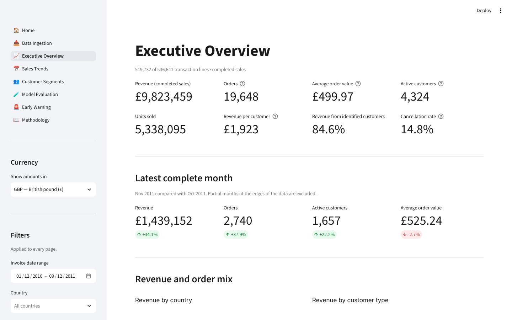
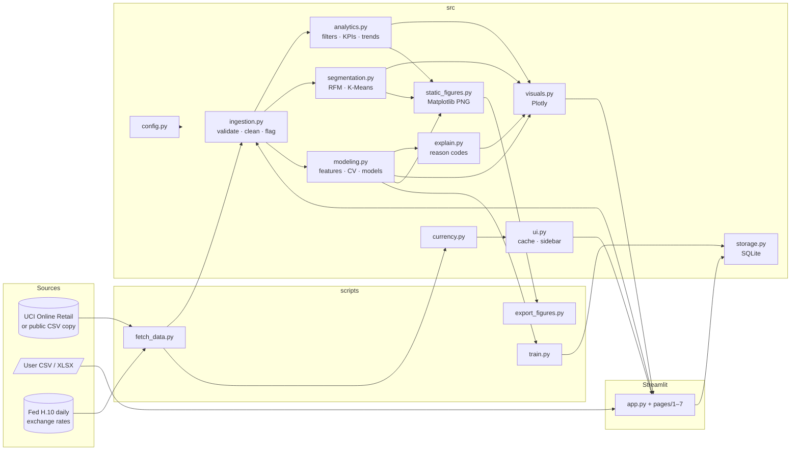
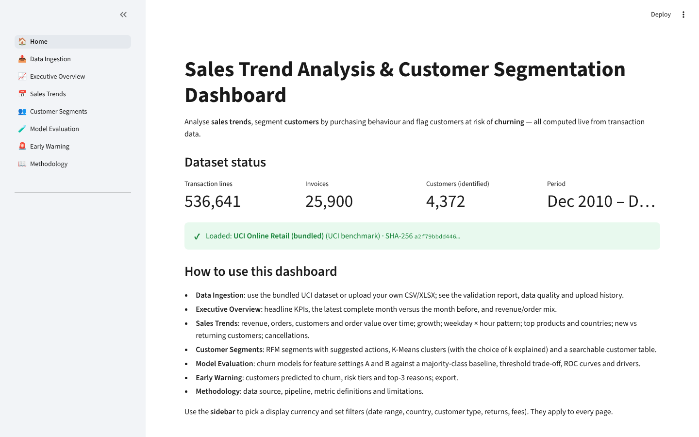
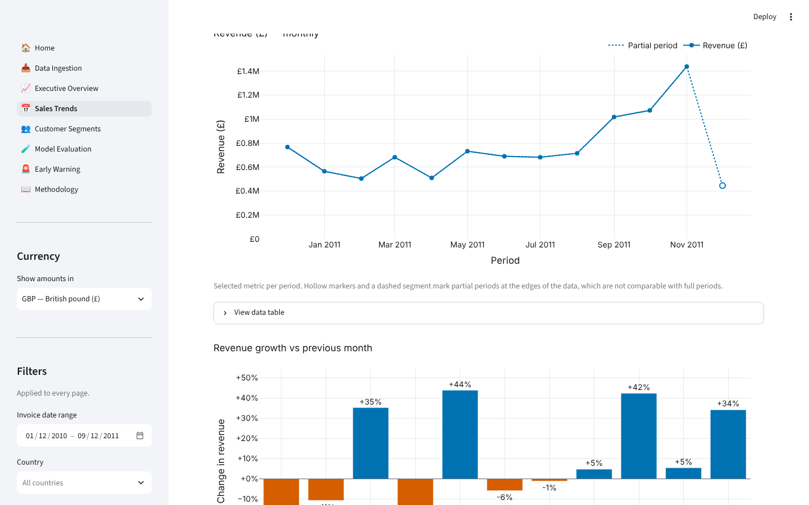
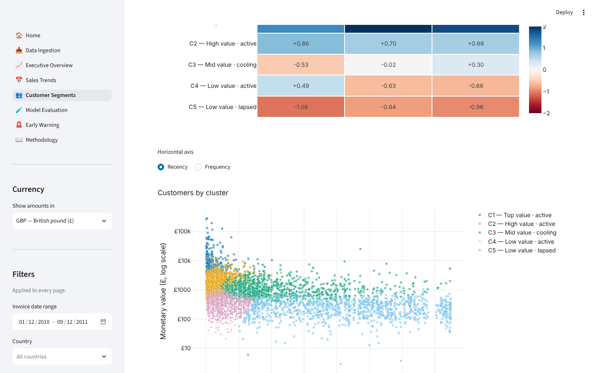
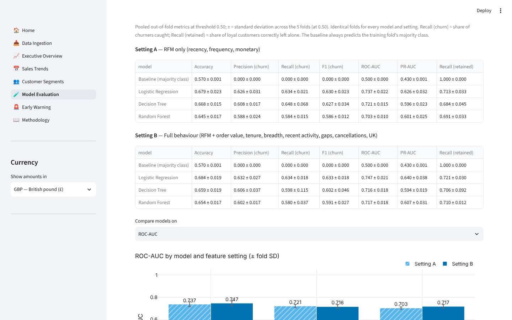
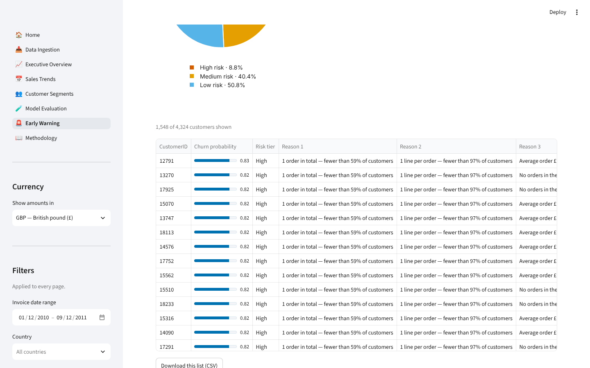
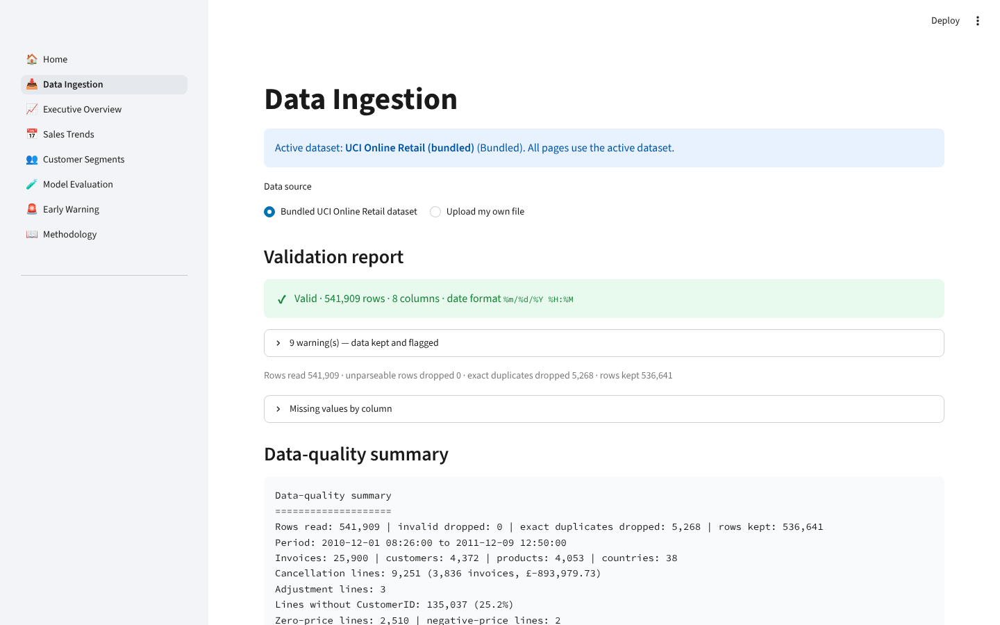

# Sales Trend Analysis & Customer Segmentation Dashboard

A Streamlit analytics dashboard for an online retailer's transactions. It provides:

- **Sales trend analysis**: KPIs, time series, growth, weekday × hour patterns, products, countries and cancellations.
- **Customer segmentation**: RFM segments with suggested actions, and K-Means clusters with an explained choice of *k*.
- **Churn early warning**: three cross-validated models compared with a baseline, risk tiers, and the top 3 reasons for each customer's score.

Every number on screen is computed at runtime from the data; nothing is hard-coded. The bundled data is the public **UCI Online Retail** dataset (541,909 transaction lines, Dec 2010 – Dec 2011). You can also upload your own CSV/XLSX.



---

## Contents
1. [Features](#features)
2. [Architecture](#architecture)
3. [Setup](#setup)
4. [Usage](#usage)
5. [Results](#results)
6. [Exported figures](#exported-figures)
7. [Testing and quality](#testing-and-quality) · [Deployment](docs/DEPLOYMENT.md)
8. [Limitations](#limitations)
9. [Next steps](#next-steps)
10. [Screenshots](#screenshots)
11. [Data source and citation](#data-source-and-citation)

---

## Features

| Page | What it does |
|---|---|
| **Home** | Project summary, navigation guide and dataset status: rows, invoices, customers, period, SHA-256, and any features unavailable for the data. |
| **Data Ingestion** | Choose the bundled dataset or upload a CSV/XLSX. Shows a structured validation report (blocking errors with example rows, warnings), missing values, cleaning log, a preview with masked customer IDs, the features the data supports, and upload history from SQLite. Original uploads are kept unchanged. |
| **Executive Overview** | 8 KPI cards, the latest complete month vs the month before, revenue concentration, donuts (revenue by country, by customer type, invoices by status) and an outlier list. |
| **Sales Trends** | Daily/weekly/monthly revenue, orders, customers, AOV and units, with partial periods marked. Growth (suppressed across partial periods), weekday × hour heatmap, top products, countries (UK can be excluded), new vs returning customers, cancellation rate, and one-click export of all figures. |
| **Customer Segments** | RFM quintile scores, 10 named segments with suggested actions, R × F grid, K-Means for k = 2–10 (inertia, silhouette, Davies–Bouldin) with the Kneedle-elbow default, cluster profiles, scatter, donut, crosstab, and a searchable customer table with CSV export. |
| **Model Evaluation** | Churn models for feature settings **A** (RFM) and **B** (full behaviour) side by side against a majority-class baseline. Toggle `class_weight="balanced"`, move a live threshold slider, and view the confusion matrix, ROC curves, importances and coefficients. Save a model with its metadata. |
| **Early Warning** | Customers predicted to churn, with probability, risk tier (High ≥ 0.7, Medium 0.4–0.7, Low < 0.4) and top-3 human-readable reasons. Search, tier filter and CSV export; each run is logged in SQLite. |
| **Methodology** | Citation, pipeline, metric definitions, latest training results and limitations (including privacy and fairness). |

**Cross-cutting features**
- Global sidebar filters (date range, country, customer type, net of returns, postage and fees) shared by every page.
- Display currency: 22 currencies at published daily rates, or any currency at a user-supplied rate.
- A colour-blind-safe palette validated for colour-vision deficiency; meaning is never carried by colour alone.
- Friendly error messages instead of stack traces, plus loading and empty states.

---

## Architecture



```
├── app.py                      # entry point: Home page
├── pages/                      # 1_Data_Ingestion … 7_Methodology (UI only, no business logic)
├── src/
│   ├── config.py               # paths, schema, constants, colours (all configuration)
│   ├── settings.py             # optional .env / environment-variable overrides
│   ├── ingestion.py            # read, validate, clean, flag, checksums, capabilities
│   ├── analytics.py            # filters, KPIs, time series, mix, customer dynamics
│   ├── currency.py             # daily-rate currency conversion
│   ├── segmentation.py         # RFM, segments, K-Means, k selection
│   ├── modeling.py             # churn dataset, pipelines, CV, metrics, persistence
│   ├── explain.py              # per-customer reason codes
│   ├── storage.py              # SQLite repository
│   ├── acquire.py              # dataset / exchange-rate download (script + first start)
│   ├── visuals.py              # Plotly figure factories
│   ├── static_figures.py       # Matplotlib 300-dpi report figures
│   └── ui.py                   # Streamlit caching, sidebar, page helpers
├── scripts/                    # fetch_data.py, train.py, export_figures.py
├── tests/                      # pytest suite
├── data/{raw,processed}/       # downloaded and cleaned data (git-ignored)
├── models/                     # saved model + JSON metadata (git-ignored)
├── reports/{figures,metrics}/  # exported PNGs, metrics.json / metrics.md (git-ignored)
├── docs/                       # DEPLOYMENT.md, screenshots/
├── .env.example                # template for optional local settings (.env is git-ignored)
└── .streamlit/config.toml      # theme, upload limit, labelled menu
```

**Design principles**
- Pages call `src/` functions only.
- Pure, typed and documented functions.
- `pathlib` only, with all configuration in `config.py`.
- Fixed seeds (42).
- Caching with `st.cache_data` / `st.cache_resource` plus a joblib cache of the cleaned data.

---

## Setup

Requires **Python 3.10+** and Git. `requirements.txt` pins the newest versions on Python 3.12+ and the newest versions that still support 3.10/3.11; the full test suite passes on 3.10, 3.11, 3.12 and 3.13.

```bash
git clone https://github.com/vishalchaudhary013/Palak-Project.git
cd Palak-Project
python -m venv .venv
```

Activate the virtual environment:

| Shell | Command |
|---|---|
| Windows PowerShell | `.\.venv\Scripts\Activate.ps1` (if blocked: `Set-ExecutionPolicy -Scope CurrentUser RemoteSigned`) |
| Windows CMD | `.venv\Scripts\activate.bat` |
| macOS / Linux | `source .venv/bin/activate` |

Install the pinned dependencies:

```bash
pip install -r requirements.txt
```

Download and prepare the data. This step is optional: the app downloads any missing files on first start. The script tries UCI first, then a public CSV copy of the same file, and also downloads the exchange rates:

```bash
python scripts/fetch_data.py
```

If downloads are blocked, follow the printed instructions, or point the script at a manual download:

```bash
python scripts/fetch_data.py --source "path/to/online+retail.zip"
```

### Local settings (`.env`, optional)

The app works without any configuration and needs **no secrets**. To change local settings, such as the default display currency, risk-tier cut-offs, churn window or folder locations, copy the template and edit it:

Windows PowerShell:

```powershell
Copy-Item .env.example .env
```

Windows CMD:

```bat
copy .env.example .env
```

macOS / Linux:

```bash
cp .env.example .env
```

Open `.env`, uncomment and change only the lines you need, for example:

```dotenv
DEFAULT_DISPLAY_CURRENCY=INR
RISK_HIGH=0.75
CHURN_HORIZON_DAYS=60
```

Then restart the app (`Ctrl+C`, then `streamlit run app.py`).

| Setting | Default | Allowed |
|---|---|---|
| `DATA_DIR`, `MODELS_DIR`, `REPORTS_DIR` | `data`, `models`, `reports` | any folder (relative to the project or absolute) |
| `DB_PATH` | `data/app.db` | SQLite file path |
| `DEFAULT_DISPLAY_CURRENCY` | `GBP` | any of the 22 currencies with published rates |
| `LARGE_LINE_QUANTITY` | `10000` | ≥ 1 |
| `EXPORT_DPI` | `300` | 72–600 |
| `CHURN_HORIZON_DAYS` | `90` | 30–180 |
| `DEFAULT_THRESHOLD` | `0.5` | between 0 and 1 |
| `RISK_HIGH` / `RISK_MEDIUM` | `0.7` / `0.4` | between 0 and 1, and Medium < High |
| `TOP_N_REASONS` | `3` | 1–5 |
| `RANDOM_STATE` | `42` | ≥ 0 |

How the settings behave:
- **Precedence:** variables already set in your terminal override `.env`, which overrides the defaults.
- **Visibility:** the Home page lists the `.env` settings that are active.
- **Invalid values:** the default is used, and every page shows a red message naming the variable. Command-line scripts print a warning.
- **Git:** `.env` is git-ignored; `.env.example` is the committed template.
- **No extra package needed:** the file is read by a small built-in parser, so `python-dotenv` isn't required.
- **Retraining:** after changing `CHURN_HORIZON_DAYS`, `RANDOM_STATE` or `DEFAULT_THRESHOLD`, run `python scripts/train.py` (or save a model on Model Evaluation) so the saved model matches.
- **Tests:** the test suite ignores `.env`, so personal settings never change test results.

### Deploying online
Step-by-step guide for **Streamlit Community Cloud** (via GitHub): [docs/DEPLOYMENT.md](docs/DEPLOYMENT.md).

---

## Usage

Run the dashboard:

```bash
streamlit run app.py
```

Train and evaluate the churn models from the command line. This writes `reports/metrics/metrics.{json,md}`, saves the best model, and registers it in SQLite:

```bash
python scripts/train.py
```

Options: `--setting A|B`, `--model "Random Forest"`, `--class-weight balanced`, `--threshold 0.4`.

Export all report figures as 300-dpi PNGs to `reports/figures/`:

```bash
python scripts/export_figures.py
```

Run the tests with coverage, then the linter and formatter:

```bash
pytest --cov=src
```

```bash
ruff check .
```

```bash
ruff format --check .
```

### Smoke-test checklist
- [ ] `python scripts/fetch_data.py` prints *Validation [OK]* with 541,909 rows and 536,641 kept.
- [ ] `streamlit run app.py`: Home shows 536,641 lines, 25,900 invoices and 4,372 customers.
- [ ] Executive Overview shows revenue (completed sales) of £9,823,459. Toggling *Net of cancellations & returns* switches the label to *Net revenue*.
- [ ] Sales Trends marks Dec 2011 as partial, and the heatmap shows *No trading recorded* on Saturday.
- [ ] Changing the currency to EUR converts every amount, and the source note appears at the top.
- [ ] Customer Segments recommends k = 5. Moving the slider updates the scores and charts.
- [ ] Model Evaluation lists settings A and B with the baseline. Moving the threshold slider updates the trade-off chart and confusion matrix.
- [ ] Early Warning lists customers with probabilities, tiers and three reasons, and the CSV downloads.
- [ ] Uploading an invalid CSV on Data Ingestion shows *Missing required column(s)*. A valid file can be made active, and switching back works.
- [ ] *Export all figures* writes 13 PNGs.

---

## Results

All figures below come from the bundled dataset with default filters, as produced by the scripts and pages in this repository.

### Data quality

| Item | Value |
|---|---|
| Rows read / kept | 541,909 / 536,641 (5,268 exact duplicates removed, 0 unparseable) |
| Period | 2010-12-01 08:26 – 2011-12-09 12:50 |
| Invoices / customers / products / countries | 25,900 / 4,372 / 4,053 / 38 |
| Lines without CustomerID | 135,037 (25.2%) |
| Cancellation lines | 9,251 (3,836 invoices) |
| Sales reversed by a matching cancellation | 2,860 lines (£436,221), including two 74k- and 81k-unit orders |

### Sales (completed sales, GBP)

| KPI | Value |
|---|---|
| Revenue | £9,823,459 |
| Orders / average order value | 19,648 / £499.97 |
| Active customers / revenue per customer | 4,324 / £1,923 |
| Cancellation rate (invoices) | 14.8% |
| Nov 2011 vs Oct 2011 | revenue +34.1%, orders +37.9%, customers +22.2%, AOV −2.7% |
| Revenue from top 1% / 10% / 20% of products | 18% / 61% / 78% |
| United Kingdom share of revenue | 84.7% |

### Customer segmentation (4,324 customers, snapshot 10 Dec 2011)

| RFM segment | Customers | Share of revenue |
|---|---|---|
| Champions | 630 (14.6%) | 50.5% |
| Loyal customers | 816 (18.9%) | 27.2% |
| At risk | 590 (13.6%) | 6.7% |
| Hibernating | 1,077 (24.9%) | 5.4% |
| *Other six segments* | 1,211 | 10.2% |

**K-Means:**
- k = 2–10 were evaluated. The Kneedle elbow gives **k = 5** (silhouette 0.317, Davies–Bouldin 0.981).
- k = 2 has the highest silhouette (0.432) but only splits customers into high and low value.

| Cluster | Customers | Share of revenue | Median recency / orders / spend |
|---|---|---|---|
| C1 — Top value · active | 379 | 54.8% | 8 d / 14 / £5,635 |
| C2 — High value · active | 965 | 22.9% | 17 d / 5 / £1,661 |
| C3 — Mid value · cooling | 997 | 15.1% | 87 d / 3 / £944 |
| C4 — Low value · active | 869 | 3.8% | 26 d / 1 / £334 |
| C5 — Low value · lapsed | 1,114 | 3.5% | 219 d / 1 / £232 |

### Churn early-warning model

- **Training set:** 3,364 customers. **Churn rate:** 43.0%. **Cut-off:** 2011-09-10, with a 90-day label window.
- **Positive class:** *churned*.
- **Validation:** StratifiedKFold(5, shuffle=True, random_state=42), using the same folds for every model and setting.
- **Metrics:** computed from out-of-fold predictions at threshold 0.5. "±" is the standard deviation across folds.

| Setting | Model | Accuracy | Precision | Recall (churn) | F1 | ROC-AUC | PR-AUC | Recall (retained) |
|---|---|---|---|---|---|---|---|---|
| A (RFM) | Baseline (majority) | 0.570 | 0.000 | 0.000 | 0.000 | 0.500 | 0.430 | 1.000 |
| A | Logistic Regression | 0.679 ± 0.023 | 0.626 | 0.634 | 0.630 | 0.737 ± 0.022 | 0.626 | 0.713 |
| A | Decision Tree (depth 5) | 0.668 ± 0.015 | 0.608 | 0.648 | 0.627 | 0.721 ± 0.015 | 0.596 | 0.684 |
| A | Random Forest (300) | 0.645 ± 0.017 | 0.588 | 0.584 | 0.586 | 0.703 ± 0.010 | 0.601 | 0.691 |
| B (full) | Baseline (majority) | 0.570 | 0.000 | 0.000 | 0.000 | 0.500 | 0.430 | 1.000 |
| **B** | **Logistic Regression** | **0.684 ± 0.019** | **0.632** | **0.634** | **0.633** | **0.747 ± 0.021** | **0.640** | **0.721** |
| B | Decision Tree (depth 5) | 0.659 ± 0.019 | 0.606 | 0.598 | 0.602 | 0.716 ± 0.018 | 0.594 | 0.706 |
| B | Random Forest (300) | 0.654 ± 0.017 | 0.602 | 0.580 | 0.591 | 0.717 ± 0.018 | 0.607 | 0.710 |

**Early warning** (Logistic Regression, setting B, scored on 9 Dec 2011):
- 4,324 customers scored; **1,548** predicted to churn.
- Risk tiers: **381** High, 1,747 Medium, 2,196 Low.

Running `python scripts/train.py` regenerates the full table, including fold standard deviations for every metric, in `reports/metrics/metrics.md`.

---

## Exported figures

`python scripts/export_figures.py` (or the button on Sales Trends) writes these figures to `reports/figures/`:

| File | Description |
|---|---|
| `01_monthly_revenue.png` | Monthly completed-sales revenue; partial months shown hollow and dashed. |
| `02_weekday_hour_heatmap.png` | Revenue by weekday × hour; grey cells mean no trading (Saturday). |
| `03_top_products.png` | Top 15 products by revenue with value labels. |
| `04_country_share.png` | Donut of revenue share by country (top 5 + Other). |
| `05_rfm_segments.png` | Share of customers vs share of revenue for each RFM segment. |
| `06_k_selection.png` | Inertia and silhouette for k = 2–10, with the elbow marked. |
| `07_cluster_profiles.png` | K-Means cluster profiles in standard-deviation units (blue = better). |
| `08_cluster_scatter.png` | Customers by recency and spend (log), coloured and shaped by cluster. |
| `09_model_comparison.png` | ROC-AUC for each model, settings A and B, against the baseline. |
| `10_roc_curves.png` | Out-of-fold ROC curves (setting B). |
| `11_confusion_matrix.png` | Confusion matrix of the best model at threshold 0.5. |
| `12_threshold_tradeoff.png` | Churn recall, precision and share flagged across thresholds. |
| `13_churn_drivers.png` | Coefficients (or importances) of the best model. |

---

## Testing and quality

- **pytest:** 120+ tests covering ingestion, analytics, currency, segmentation, modelling, explanations, storage, figure export, the CLI scripts, and headless runs of every page (`streamlit.testing`). **Coverage of `src/` is 96%** with the dataset downloaded (126 tests). On a fresh checkout without data, the 16 data-dependent tests skip automatically and coverage is 81% (110 tests).
- **Real-data checks:** reference figures such as 541,909 rows, 25,900 invoices, 4,372 customers, k = 5, a churn rate of 43% and the 2011 GBP/USD average of 1.604 are asserted against the real files.
- **ruff:** lint (pycodestyle, pyflakes, isort, bugbear, pyupgrade, naming, simplify, pydocstyle) and format are both clean.
- **Machine-learning hygiene:**
  - All preprocessing sits inside scikit-learn Pipelines, so it is fitted on training folds only.
  - Features come only from before the cut-off.
  - The baseline is fitted in each training fold.
  - Seeds are fixed.
  - The saved model carries its features, preprocessing, validation strategy, metrics, data checksum, library versions and timestamp.

---

## Limitations

- **One retailer, one year.** A UK online giftware wholesaler/retailer, Dec 2010 – Dec 2011; findings may not generalise. December 2011 is partial (to the 9th).
- **Guest sales** (25% of lines) have no CustomerID and are excluded from segmentation and churn.
- **Churn is defined by 90 days of inactivity** with a single cut-off, so seasonal and one-off buyers can be mislabelled.
- **Modest predictive power.** The best ROC-AUC is 0.747, and richer behaviour adds little over RFM (0.737). Scores are a prioritisation aid, not a verdict.
- **Correlation is not causation.** Importances and reason codes describe the model's associations; correlated features share credit and can produce counter-intuitive reasons.
- **Cancellation matching is exact.** A cancellation is matched to its sale only when customer, product and quantity agree; partial returns are netted only in *net of returns* mode.
- **Currency.** Federal Reserve noon rates are used (the ECB was unreachable from the build environment); actual settlement rates differ.
- **Privacy and fairness.** Customer IDs are pseudonymous but still personal data. The preview masks IDs by default, SQLite stores only metadata, and exports should be shared on a need-to-know basis. Country is a model feature, so scores must not be used to disadvantage customers by location.

## Next steps

- **Validation over time:** test on several cut-offs (rolling origin), and calibrate the probabilities.
- **Richer models:** try gradient boosting (e.g. scikit-learn's `HistGradientBoostingClassifier`) and Customer Lifetime Value models (BG/NBD and Gamma-Gamma). The latter would need a new dependency.
- **Better reasons:** SHAP explanations (new dependency) or grouped occlusion for correlated features.
- **Product analytics:** basket and association analysis, and product-level demand forecasting.
- **Operations:** scheduled re-training, monitoring of data drift and model performance, and role-based access to customer-level exports.

---

## Screenshots

Real captures from the running app (1440 × 900). To refresh them, run the app and capture the same views into `docs/screenshots/`.

| | |
|---|---|
|  Home |  Executive Overview |
|  Sales Trends |  Customer Segments |
|  Model Evaluation |  Early Warning |
|  Data Ingestion | |

---

## Data source and citation

**UCI Online Retail.** D. Chen, S. L. Sain and K. Guo, *Data mining for the online retail industry: A case study of RFM model-based customer segmentation using data mining*, Journal of Database Marketing and Customer Strategy Management 19(3), 197–208, 2012. UCI Machine Learning Repository, <https://doi.org/10.24432/C5BW33> (CC BY 4.0).

**Exchange rates:** US Federal Reserve H.10 daily rates (via FRED), packaged by datahub.io `core/exchange-rates` (ODC-PDDL).
